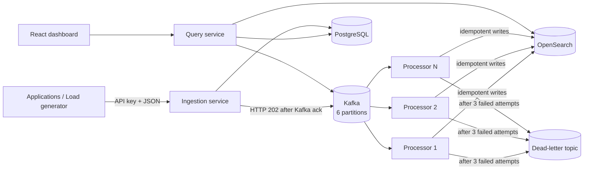

<div align="center">

# EventLens

### Real-time distributed log search and analytics

Collect structured application logs, buffer them through Kafka, index them in OpenSearch, and investigate them from a React dashboard.

[](https://openjdk.org/)
[](https://spring.io/projects/spring-boot)
[](https://kafka.apache.org/)
[](https://opensearch.org/)
[](https://react.dev/)
[](https://docs.docker.com/compose/)
[](LICENSE)

</div>

## What is EventLens?

EventLens is a locally runnable observability platform for learning and demonstrating backend and distributed-systems engineering. Applications submit structured logs to an authenticated API. Kafka absorbs bursts and distributes the records across processors. The processors index them in OpenSearch, where a query service and dashboard provide full-text search, filters, analytics, trace reconstruction, alert rules, consumer lag, and dead-letter replay.

This is more than a CRUD demo. It exercises partitioning, ordering, at-least-once delivery, idempotency, eventual consistency, bounded retries, dead-letter handling, horizontal scaling, database migrations, and container orchestration.

## Highlights

- Authenticated single and batch ingestion with validation and rate limiting
- Six-partition Kafka pipeline keyed by service for per-service ordering
- Horizontally scalable processing consumer group
- Time-based OpenSearch indices with strict mappings
- Full-text log search plus service, environment, level, time, and trace filters
- Cross-service trace reconstruction in chronological order
- Analytics for volume, error rate, service distribution, and severity
- Idempotent indexing using `eventId` as the OpenSearch document ID
- Three bounded indexing attempts followed by a diagnostic dead-letter event
- Dead-letter inspection and replay APIs
- PostgreSQL-backed projects, hashed API keys, alert rules, and alert history
- React and TypeScript operations dashboard
- Docker Compose, Kubernetes manifests, CI, load generation, ADRs, and test scripts

## Architecture



```text
Validate → publish to Kafka → consume → index → search
                                      └→ retry ×3 → dead letter → replay
```

The ingestion response confirms that Kafka accepted the record. Searchability follows asynchronously, so the system is intentionally eventually consistent.

## Technology

| Area | Technology |
|---|---|
| Backend | Java 17, Spring Boot 3.5, Spring Kafka, Maven |
| Event streaming | Apache Kafka 7.7 in KRaft mode |
| Search | OpenSearch 2.17 |
| Relational storage | PostgreSQL 16, Flyway |
| Frontend | React, TypeScript, Vite, Recharts |
| Operations | Docker Compose, Kubernetes, GitHub Actions |
| Testing | JUnit 5, PowerShell end-to-end scripts |

## Quick start

### Prerequisites

- Docker Desktop
- At least 6 GB of memory available to Docker; 8 GB is recommended
- PowerShell for the supplied test scripts

Java 17, Maven, and Node.js are only required when building outside Docker.

### Start everything

```powershell
git clone https://github.com/laxmanmudigonda/Event-Lens.git
cd Event-Lens
Copy-Item .env.example .env
docker compose up --build -d
docker compose ps
```

Wait until the containers report `healthy`, then open:

- Dashboard: <http://localhost:3000>
- Ingestion API: <http://localhost:8081>
- Query API: <http://localhost:8083>
- OpenSearch: <http://localhost:9200>

The seeded development API key is:

```text
evl_dev_key
```

It is intentionally local-only and must be replaced outside a demo environment.

## Submit and find your first event

```powershell
$headers = @{'X-API-Key'='evl_dev_key'}
$body = @{
  service = 'payment-service'
  environment = 'demo'
  level = 'ERROR'
  message = 'Payment provider timeout'
  traceId = 'trace-demo-123'
  metadata = @{ transactionId = 'tx-7' }
} | ConvertTo-Json

Invoke-RestMethod -Method Post `
  -Uri 'http://localhost:8081/api/v1/logs' `
  -Headers $headers `
  -ContentType 'application/json' `
  -Body $body

Start-Sleep -Seconds 3
Invoke-RestMethod 'http://localhost:8083/api/v1/search?q=Payment%20provider%20timeout'
```

You can also open the dashboard, use **Logs** to search for the message, and use **Trace** with `trace-demo-123`.

## Dashboard

The UI contains four focused views:

- **Overview** — indexed-event totals, errors, warnings, active services, timeline, and distributions
- **Logs** — full-text search, exact filters, newest-first results, and complete event details
- **Trace** — chronological reconstruction of one trace across multiple services
- **Alerts** — creation and inspection of persistent five-minute error-threshold rules

## API overview

| Method | Endpoint | Purpose |
|---|---|---|
| `POST` | `/api/v1/logs` | Submit one authenticated log event |
| `POST` | `/api/v1/logs/batch` | Submit up to 500 events atomically |
| `POST` | `/api/v1/admin/projects` | Create a project and API key |
| `GET` | `/api/v1/search` | Search and filter indexed events |
| `GET` | `/api/v1/analytics/overview` | Fetch dashboard aggregations |
| `GET` | `/api/v1/system/kafka` | Inspect consumer-group lag |
| `GET` | `/api/v1/dead-letters` | Inspect recent failed events |
| `POST` | `/api/v1/dead-letters/{eventId}/replay` | Replay a failed event |
| `GET` / `POST` | `/api/v1/alerts` | List or create alert rules |

Search supports `q`, `service`, `environment`, `level`, `from`, `to`, `traceId`, `page`, `size`, and `sort`. Page size is capped at 200, and deep pagination beyond 10,000 results is rejected.

## Verify the system

### Health checks

```powershell
Invoke-RestMethod http://localhost:3000/health
Invoke-RestMethod http://localhost:8081/actuator/health
Invoke-RestMethod http://localhost:8083/actuator/health
```

### End-to-end and idempotency tests

```powershell
.\scripts\smoke-test.ps1
.\scripts\duplicate-test.ps1
```

Expected results:

```text
PASS: event ... traversed ingestion -> Kafka -> OpenSearch -> query
PASS: duplicate delivery overwrote the same OpenSearch document ID
```

### Failure and recovery test

```powershell
.\scripts\failure-demo.ps1
```

This deliberately stops the local OpenSearch container, submits an event, verifies bounded retries and dead-lettering, restores OpenSearch, and replays the event.

### Host builds

```powershell
mvn test
Set-Location frontend
npm install
npm run build
Set-Location ..
```

Unit tests cover server-managed event fields, API-key hashing, UTC index naming, safe query generation, pagination caps, and deep-pagination rejection.

## Scaling and Kafka lag

Scale the processor tier independently:

```powershell
docker compose up -d --scale processing-service=3
docker compose exec kafka kafka-consumer-groups `
  --bootstrap-server kafka:29092 `
  --describe `
  --group eventlens-indexers
```

Kafka rebalances six partitions across the live processors. More than six processor replicas do not add active consumption capacity because one partition is assigned to only one member of a consumer group.

The query API also exposes lag:

```powershell
Invoke-RestMethod http://localhost:8083/api/v1/system/kafka
```

## Load generation

```powershell
mvn -pl load-generator -am package -DskipTests
java -jar load-generator/target/load-generator-1.0.0-SNAPSHOT.jar `
  --rate=100 --duration=60 --error-rate=0.05
```

One local functional run on an AMD Ryzen 7 5700U accepted and indexed 999 of 999 events at 99.74 requests/second with zero final Kafka lag. This is a reproducibility sample, not a production capacity claim. See [the benchmark notes](docs/benchmarks.md) for context and procedure.

## Delivery and failure semantics

- Producers use `acks=all` and idempotence.
- Consumers manually acknowledge only after successful indexing or successful dead-letter publication.
- Delivery is at least once; a record can repeat after a failure between indexing and offset commit.
- Repeated delivery is safe because `eventId` is the deterministic OpenSearch document ID.
- An OpenSearch failure receives three increasing-backoff attempts before a diagnostic DLT record is published.
- If DLT publication also fails, the Kafka offset remains uncommitted for later redelivery.

## Repository layout

```text
Event-Lens/
├── services/
│   ├── event-model/          Shared event contracts
│   ├── ingestion-service/    Authentication, validation, Kafka publishing
│   ├── processing-service/   Kafka consumption, indexing, retry and DLT
│   └── query-service/        Search, analytics, alerts, lag and replay APIs
├── frontend/                 React and TypeScript dashboard
├── load-generator/           Configurable Java workload generator
├── scripts/                  Smoke, duplicate, benchmark and failure tests
├── docs/                     Architecture, ADRs and interview material
├── k8s/                      Application Kubernetes manifests
├── .github/workflows/        CI pipeline
├── docker-compose.yml        Complete local environment
└── pom.xml                   Multi-module Maven build
```

## Documentation

- [Architecture](docs/architecture.md)
- [Kafka design](docs/kafka-design.md)
- [Search design](docs/search-design.md)
- [Database design](docs/database-design.md)
- [Failure handling](docs/failure-handling.md)
- [Scaling](docs/scaling.md)
- [Architecture decisions](docs/adr)
- [Benchmark methodology and results](docs/benchmarks.md)
- [Demo script](docs/demo-script.md)
- [Interview questions and answers](docs/interview-notes.md)

## Useful operations

```powershell
docker compose logs -f                    # Follow all logs
docker compose logs -f processing-service # Follow processor logs
docker compose restart                    # Restart without deleting data
docker compose down                       # Stop; named volumes remain
docker compose up -d                       # Start existing images
docker compose up --build -d               # Rebuild after changes
```

## Local-development limitations

- Kafka and OpenSearch run as single nodes with replication factor one.
- The ingestion rate limiter is local to each replica rather than globally coordinated.
- The DLT administration cache is bounded and in memory.
- Alert rules are evaluated, but this demo does not integrate email, Slack, or PagerDuty notifications.
- Alert cooldown and notification deduplication are future work.
- Deep result traversal should eventually use `search_after` rather than page/size.
- Local containers disable production-grade TLS, SASL, and multi-tenant authorization.

## Roadmap

Schema Registry and Avro, OAuth/RBAC, Redis-backed global rate limits, alert cooldowns and notification channels, OpenSearch ISM retention, Prometheus/Grafana metrics, `search_after`, TLS/SASL, and multi-node infrastructure.

## License

Released under the [MIT License](LICENSE).

