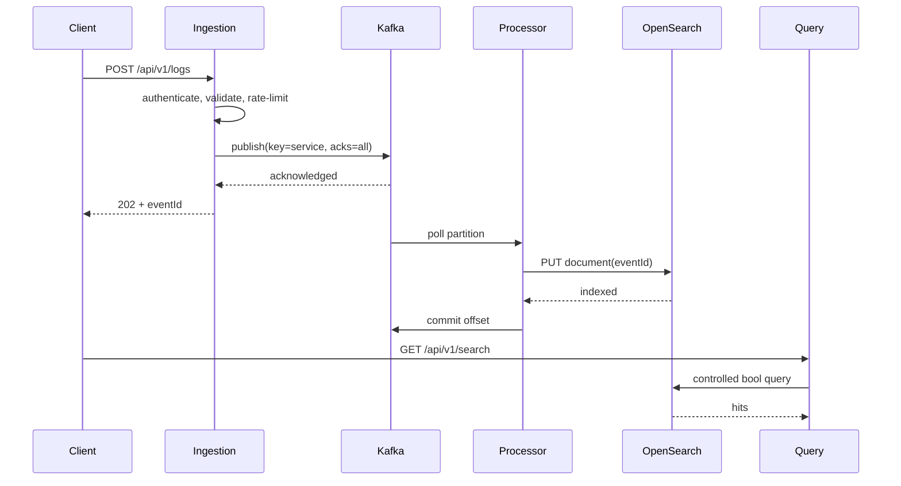

# Architecture

EventLens separates the fast acceptance path from the slower search-indexing path. The ingestion service validates identity and shape, converts requests into immutable `LogEvent` records, and waits only for Kafka producer completion. Processing replicas share a consumer group. The query service is deliberately read-oriented and owns search, analytics, alert evaluation, lag reporting, and DLT administration.

At-least-once delivery is chosen because acknowledging before indexing risks loss. The unavoidable duplicate window is closed at the sink with deterministic document IDs. Backpressure accumulates as Kafka lag instead of tying up HTTP request threads.

